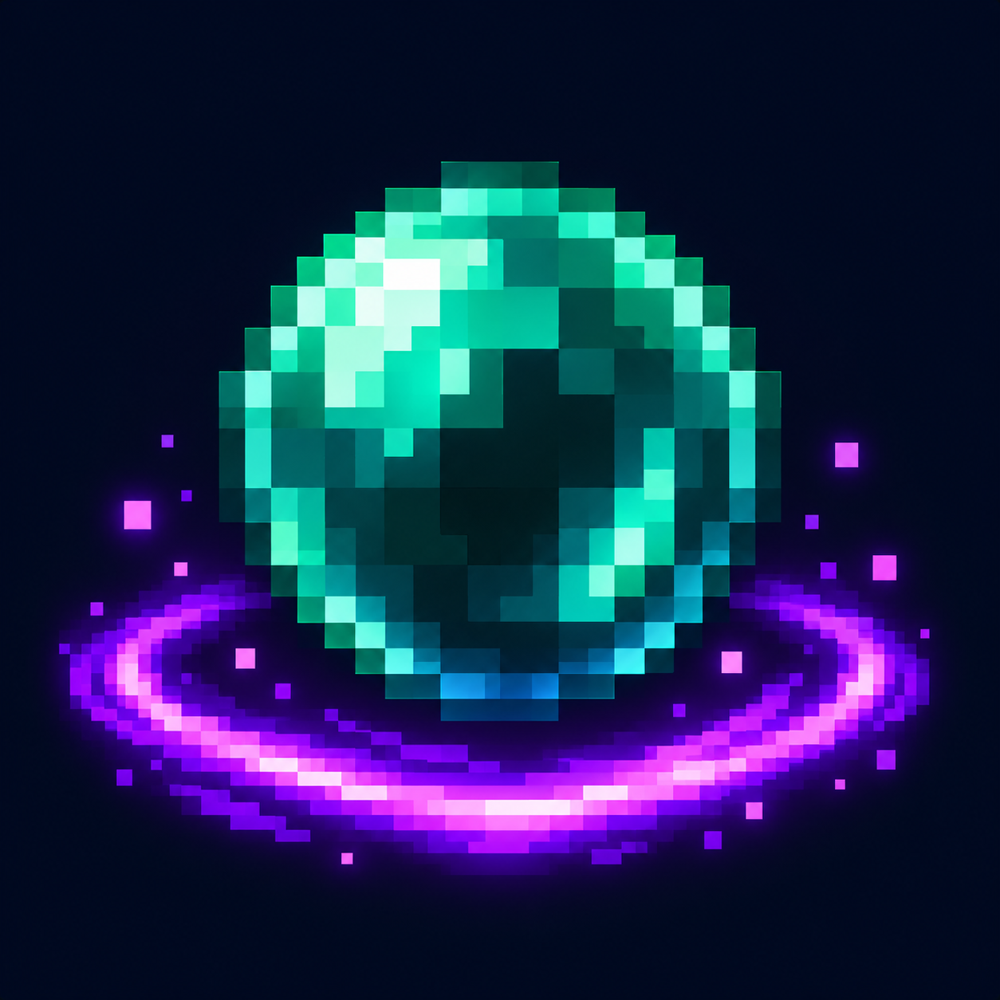

# Pearl Pull on Stream Deck Neo

One press on your Neo sends the same **F8** request as the keyboard shortcut:
one right-click on the second PC. The Neo connects to **PC 1**, where your son
plays. **PC 2** runs the receiver, with Minecraft aimed at the trapdoor.

The included [PNG icon](icons/pearl-pull.png) is ready to assign to a key. The
Stream Deck app scales the square image to fit the Neo's display. It has no
baked-in text, so it stays readable on a small button.

## Set up the Neo button

1. Connect **Stream Deck Neo to PC 1** and open the Elgato **Stream Deck** desktop
   app. If needed, get the app from [Elgato Downloads](https://www.elgato.com/downloads).
2. **Close any running Pearl Pull sender window before recording F8.** This
   prevents the editor's key-recording step from triggering a click on PC 2.
   This includes `Start-Hotkey.cmd` and `Start-StreamDeck-Neo.cmd` windows.
3. Select your **Neo** in the device selector. In your usual profile, drag
   **System → Hotkey** onto one of its eight square keys. The bottom-left key
   can be easy to reach beside a keyboard. Use the regular Hotkey action for
   this button.
4. Click the **Hotkey** field and press **F8**. Leave the **Title** blank for the
   clean icon, or use a short title such as `PEARL` if you prefer.
5. Open the selected key's icon menu, choose **Set from File**, and select
   **`icons\pearl-pull.png`** from this folder. Your Neo should now show the
   teal pearl and purple ring. Keep the button on a page/profile you use while
   playing Minecraft.

This uses Stream Deck's built-in Hotkey action. You do not need to install a
custom Stream Deck plugin or import a device profile.

## Start playing

1. Complete the [first-time network pairing and firewall setup](README.md#first-setup)
   if you have not already. Use **Start-StreamDeck-Neo.cmd** on PC 1 in place
   of **Start-Hotkey.cmd**; it asks for the same PC 2 address and pairing code
   on first use and reuses existing settings thereafter. If both tools are
   still running from first setup, continue at step 4.
2. On **PC 2**, open **Start-Receiver.cmd**, then return to Minecraft. Leave
   the second account still, in reach, with the crosshair on the trapdoor and
   menus/chat closed.
3. On **PC 1**, open **Start-StreamDeck-Neo.cmd**. Wait for
   `Network check: ready` and the F8 instruction. Keep this window running;
   you can minimize it. Run one sender at a time.
4. Press the **pearl icon on the Neo once**. The sender requests a single
   right-click on PC 2. The keyboard's F8 key remains available as well.

Try this with an expendable pearl first. Confirm that the trapdoor operates
and the intended player teleports. Keep the receiver window running and
Minecraft focused on PC 2, and re-arm the chamber after use.

Once that works, you can [install automatic startup at Windows sign-in](STARTUP-AND-WINDOWS-SECURITY.md#start-automatically-when-the-player-signs-in)
on each PC so the daily launchers are no longer needed. The Neo still sends F8.

The icon is a static button label. It does not indicate whether the chamber is
armed, the receiver is connected, or the teleport succeeded. The sender window
shows request results such as `clicked`, `unfocused`, or `cooldown`; see the
[troubleshooting table](README.md#troubleshooting) for their meanings.

## If pressing the Neo key does nothing

- Confirm the button is **System → Hotkey: F8**, and that the F8 sender is running
  on the same PC that the Neo is connected to. The button sends a hotkey; it
  does not launch the sender itself.
- Press physical **F8** on PC 1. If that works, check the Neo's active page,
  profile, and hotkey assignment. If both fail, use the main troubleshooting
  guide to check the receiver and network.
- An `unfocused` result means PC 2 needs to return to Minecraft. Aim at the
  trapdoor again after closing menus or changing windows.
- Close duplicate sender windows if you see “hotkey already registered.”

## Artwork

The included icon is original AI-generated artwork made for this utility.
The full square PNG is included so you can use it directly in the Stream Deck
app. The button integration uses the existing authenticated sender/receiver;
the icon contains no configuration or pairing information.
